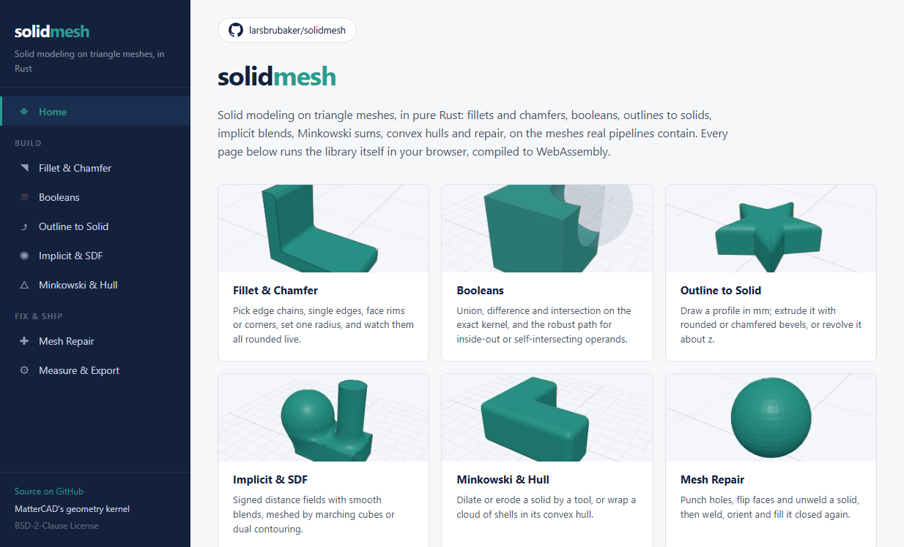

# solidmesh

[](https://crates.io/crates/solidmesh)
[](https://docs.rs/solidmesh)
[](LICENSE)
[](https://larsbrubaker.github.io/solidmesh/)

**Solid modeling on triangle meshes, in pure Rust: booleans, fillets and chamfers, repair, and
implicit (SDF) operations that keep closed solids closed.**

[](https://larsbrubaker.github.io/solidmesh/)

<p align="center"><a href="https://larsbrubaker.github.io/solidmesh/"><b>▶ Try the live demo</b></a></p>

solidmesh is the geometry kernel behind MatterCAD, moved out of the application into its own
library so that others can use it and build on it. It works on the meshes real pipelines contain
(STL and 3MF downloads, scans, triangle soup) as well as on clean modeled parts, builds for
`wasm32-unknown-unknown`, contains no C or C++, and gives the same answer on every platform.

> Part of the [rust-apps](https://github.com/larsbrubaker/rust-apps) suite — a collection of Rust graphics and geometry libraries by Lars Brubaker.

## Status

**0.2.0 is on crates.io.** The four crates moved in from the MatterCAD workspace with their
history, and MatterCAD depends on them by path, from a solidmesh checkout beside its own. Fillets
and chamfers are one call, `solidmesh::bevel_part`, whose request carries the constructions it
may take (`BevelRouting`; the default is MatterCAD's) and whose outcome reports refusals as codes
for the caller to word. The documented API on docs.rs is the semver promise; the `solidmesh`
crate also has modules hidden from its docs (the constructions and the readings MatterCAD builds
on), which may change in any release.

## Crates

| Crate | Links | Import as | Folder | What it holds |
|---|---|---|---|---|
| [`solidmesh`](https://crates.io/crates/solidmesh) | [docs](https://docs.rs/solidmesh) | `solidmesh` | `crates/geometry-processing` | Fillets and chamfers on mesh edges, corners and outlines, and picking what to round; re-exports the other three as `solidmesh::math`, `solidmesh::clipper` and `solidmesh::mesh` |
| [`solidmesh-mesh`](https://crates.io/crates/solidmesh-mesh) | [docs](https://docs.rs/solidmesh-mesh) | `solidmesh_mesh` | `crates/polygon-mesh` | The triangle mesh; welding, winding, measures; booleans on [manifold-rust](https://github.com/larsbrubaker/manifold-rust); repair; SDF and implicit meshing; convex hull and Minkowski sums; extrusion and revolution of 2D outlines; slicing; ray tracing; STL |
| [`solidmesh-clipper`](https://crates.io/crates/solidmesh-clipper) | [docs](https://docs.rs/solidmesh-clipper) | `solidmesh_clipper` | `crates/clipper-library` | A Clipper 6.4.2 port (integer polygon booleans, offsets, simplification) and the polygon helpers on clipper2-rust's types that the kernel slices, extrudes and revolves with |
| [`solidmesh-math`](https://crates.io/crates/solidmesh-math) | [docs](https://docs.rs/solidmesh-math) | `solidmesh_math` | `crates/vector-math` | Vectors, matrices, quaternions, planes, rays and bounds in `f64` and `f32`; a BVH; colours, rectangles and the progress reporter the kernel shares with its callers |

The folders keep the names MatterCAD has always used, so the history follows the files.

## Using it

`solidmesh` is the one dependency:

```toml
[dependencies]
solidmesh = "0.2"
```

```rust
use std::sync::Arc;

use solidmesh::mesh::solids::platonic_solids::create_cube;
use solidmesh::mesh::CancelToken;
use solidmesh::{bevel_part, pick, BevelPartRequest, BevelSelectionKind, FaceGroup, FeatureEdgeSet};

// A 20 mm cube and its sharp edges, read at a 20 degree bend threshold.
let cube = Arc::new(create_cube(20.0, 20.0, 20.0));
let edges = FeatureEdgeSet::create_with_angle(&cube, 20.0);

// Pick one edge and round it with a 3 mm fillet of 8 segments.
let picked = pick::group_from_edge(
    &edges,
    0,
    BevelSelectionKind::Edge,
    FaceGroup::DEFAULT_CURVE_TOLERANCE_DEGREES,
)?;
let request = BevelPartRequest::new(Some(cube), vec![picked], 3.0, 8, true, 20.0);
let outcome = bevel_part(request, &CancelToken::new(), None)?;

// One row per pick: built, or refused with a code and the largest size that fits.
let rounded = outcome.mesh; // None when nothing built
```

`solidmesh::pick` turns a click on a part into a pick (an edge, its tangent chain, a face's rim or
a corner); `solidmesh::path` rounds the corners of 2D contours. Booleans, outlines, implicit
surfaces and STL are in `solidmesh::mesh`. The [demo's bindings](demo/wasm/src) use only this
documented API, and are a worked example of each.

## Demo

The [live demo](https://larsbrubaker.github.io/solidmesh/) runs the library itself in the browser,
compiled to WebAssembly: fillets and chamfers through their one entry point,
`solidmesh::bevel_part` (pick edge chains, single edges, face rims or corners on a part, set
one radius for them all, and see the part rounded in one call; a pick that does not fit is refused
with the size that would), booleans (including inside-out and self-intersecting operands), outlines
extruded with bevels or revolved, smooth implicit blends meshed by marching cubes or dual
contouring, Minkowski sums and convex hulls, mesh repair, a part to measure and download as STL,
and a physically based path traced view of a part (the library's path tracer, with material and
light presets, at up to a million triangles). Each page shows the operation's time and the result's triangle
count, volume and area.

It lives in `demo/`: `demo/wasm` is the bindings crate (a workspace member, never published), the
pages are TypeScript built with [Bun](https://bun.sh), and `.github/workflows/deploy-demo.yml`
publishes it to GitHub Pages on every push to `main`. To run it locally, from `demo/`:

```
bun install
bun run build:wasm     # wasm-pack build into demo/public/pkg
bun run dev            # http://localhost:3030
```

With the dev server running, `bun run capture:thumbs` renders the page thumbnails and
`bun run capture:hero` screenshots the home page into `README_HERO.png`, both through a headless
Edge or Chrome (`demo/capture-thumbs.ts` says how).

## Design rules

- **Pure, safe Rust.** No C or C++, no `-sys` crates, no native build scripts; every library
  crate builds for `wasm32-unknown-unknown`.
- **Deterministic.** `f64` geometry in a stable operation order, never `mul_add`; explicit
  tie-breaks wherever order reaches a result.
- **Closed in, closed out.** An operation on a closed solid returns a closed solid or a typed
  refusal that says why, with the largest size that would have worked where there is one.
- **Errors are values.** Library code returns `Result`s and never panics on input.

## Building

The crates depend on three sibling libraries by path, so check them out beside this repository:

```
<any folder>/
  solidmesh/       github.com/larsbrubaker/solidmesh
  manifold-rust/   github.com/larsbrubaker/manifold-rust
  clipper2-rust/   github.com/larsbrubaker/clipper2-rust
  tess2-rust/      github.com/larsbrubaker/tess2-rust
```

`rust-toolchain.toml` pins the Rust version (rustup installs it on first use). From
`solidmesh/`:

```
cargo fmt --check
cargo clippy --workspace --all-targets -- -D warnings
cargo nextest run --workspace     # or: cargo test --workspace
```

The tests include the repository gates (file headers and size, Markdown placement, permissive
licenses and pure-Rust dependencies, the browser-safe clock); CI runs the same commands plus a
`wasm32-unknown-unknown` build of every library crate.

## License

BSD-2-Clause ([LICENSE](LICENSE)). Third-party code the crates adapt is listed, by the crate
that carries it, in [THIRD_PARTY_NOTICES.md](THIRD_PARTY_NOTICES.md).
